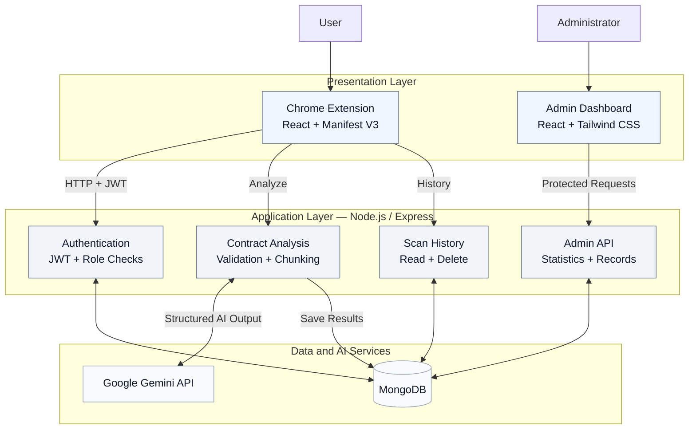
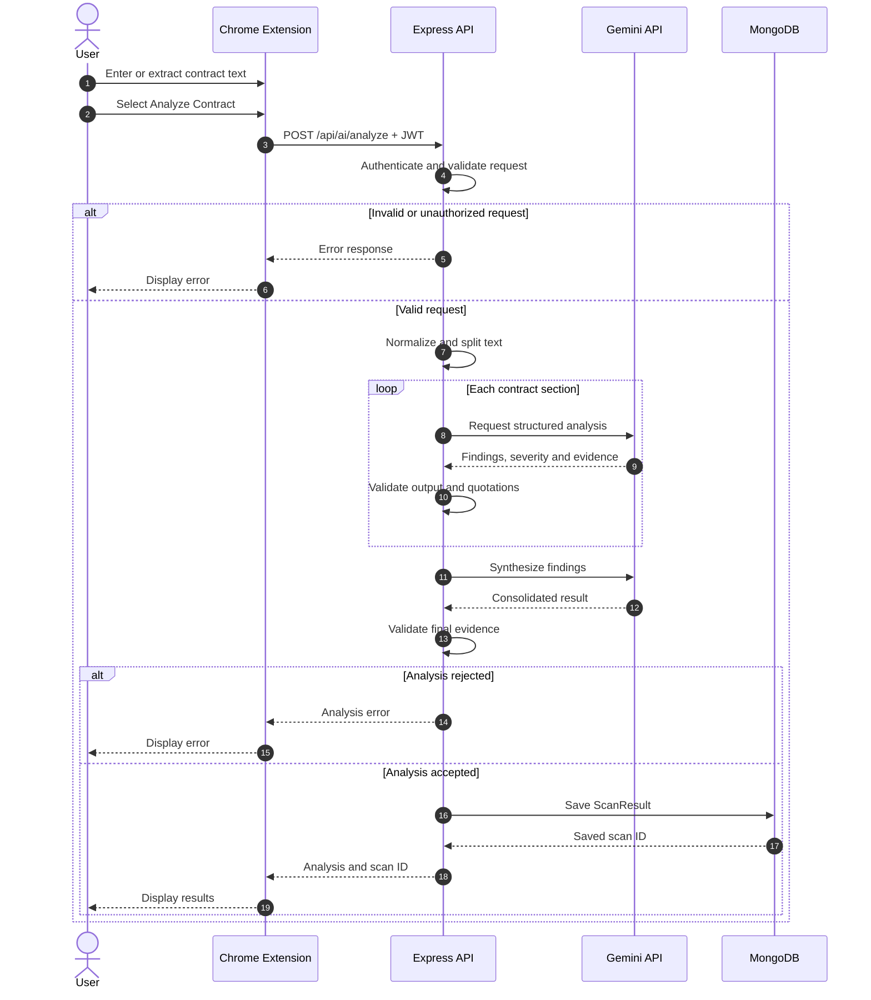
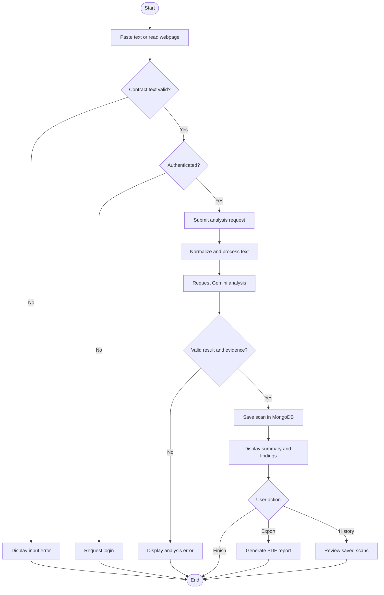

<div align="center">

# ClearContract

### Understand the terms before you agree.

**AI-assisted contract analysis for clearer digital agreements.**

A Chrome extension that helps users identify potentially concerning contractual terms, understand their implications and review supporting evidence — without navigating pages of legal language.

<br/>

[](https://github.com/XDecoder12/ClearContract)
[](https://github.com/XDecoder12/ClearContract)
[](https://github.com/XDecoder12/ClearContract)
[](https://github.com/XDecoder12/ClearContract)

<br/>

**[Features](#features)** · **[Architecture](#system-architecture)** · **[Tech Stack](#technology-stack)** · **[Setup](#getting-started)** · **[Engineering](#software-engineering)**

<br/>

<sub>Version 1.0 · Academic prototype · Local development</sub>

</div>

---

## Overview

Digital agreements often contain clauses concerning automatic renewals, cancellation conditions, unexpected charges, data usage and limitations of liability. Understanding these terms can require considerable time and legal familiarity.

**ClearContract** is designed to make this review more accessible.

Users can paste an agreement or extract text from the active webpage, submit it for AI-assisted analysis and receive a structured summary of potential consumer risks.

Each supported finding includes a category, severity classification, explanation and supporting quotation from the supplied agreement.

The application also provides authenticated scan history, PDF reporting and a separate administrator dashboard.

> [!IMPORTANT]
> ClearContract is an informational analysis tool, not a legal adviser. AI-generated results may be incomplete or inaccurate. A LOW risk classification does not guarantee that an agreement is safe.

## Features

<table>
<tr>
<td width="50%" valign="top">

### Contract analysis

- Manually paste contract text
- Extract text from the active webpage
- Analyze using Google's Gemini API
- Handle longer contracts through chunked analysis
- View an AI-generated summary

</td>
<td width="50%" valign="top">

### Risk identification

- Overall LOW / MEDIUM / HIGH assessment
- Individual finding severity
- Consumer-friendly explanations
- Supporting contract quotations
- Validation of structured AI responses

</td>
</tr>
<tr>
<td width="50%" valign="top">

### Personal workspace

- Account registration and login
- Persistent authentication state
- User-specific saved history
- Search, filter and sort scans
- Delete previous analyses
- Export analysis reports as PDF

</td>
<td width="50%" valign="top">

### Administration

- Role-protected admin dashboard
- Registered-user statistics
- Recent scan activity
- Frequently detected risk categories
- Searchable user directory
- Paginated analysis records

</td>
</tr>
</table>

## How It Works

<div align="center">

**01 — Provide text** → **02 — Analyze** → **03 — Review findings** → **04 — Save or export**

</div>

**1. Provide the agreement.** Paste contract text into the extension or read the current webpage. The application accepts text of up to 200,000 characters.

**2. Request analysis.** The authenticated extension submits the text to the Express backend. Long inputs are divided into overlapping sections for processing.

**3. Evaluate findings.** Gemini returns structured observations. The backend validates their format and checks supporting quotations against the supplied contract, allowing whitespace differences.

**4. Review and retain results.** Valid analyses are saved in MongoDB and displayed in the extension. Users can revisit them through History or download PDF reports.

An unsuccessful analysis is reported as an error rather than being silently treated as a safe contract.

---

## Technology Stack

ClearContract is built using a JavaScript-based full-stack architecture with separate browser, API, database and administrative components.

| Layer | Technology | Purpose |
|:---|:---|:---|
| **Browser Extension** | React 19, JavaScript | Interactive contract-scanning interface |
| **Extension Platform** | Chrome Manifest V3 | Browser permissions, popup integration and webpage extraction |
| **Frontend Build** | Vite 8 | Development tooling and production builds |
| **Backend API** | Node.js, Express 5 | REST endpoints and application logic |
| **Database** | MongoDB, Mongoose | Account and analysis persistence |
| **AI Integration** | Google Gemini API | Contract summarization and potential-risk identification |
| **Authentication** | JWT, bcryptjs | Session tokens and password hashing |
| **PDF Reports** | jsPDF | Client-side report generation |
| **Admin Dashboard** | React, Tailwind CSS | Administrative overview and data presentation |
| **Backend Testing** | Jest, Supertest | Automated endpoint and behavior verification |
| **Test Database** | MongoDB Memory Server | Isolated MongoDB-backed tests |
| **Security Middleware** | Helmet, CORS, express-rate-limit | Security headers, origin restrictions and request limiting |
| **Version Control** | Git, GitHub | Collaborative development and change history |

### Why these technologies?

**React** provides a component-based interface for the extension and dashboard. **Express** separates HTTP request handling from the browser interface and keeps Gemini credentials server-side.

**MongoDB** supports document-oriented storage of users and scan results, including arrays of detected findings. **Gemini** provides structured natural-language analysis, while backend validation checks the format and evidence of its responses.

**Jest and Supertest** allow API behavior to be tested without relying on a live Gemini response for every automated test.

---

## System Architecture

ClearContract follows a client-server architecture with separated presentation, service and persistence responsibilities.



### Component responsibilities

| Component | Responsibility |
|---|---|
| Chrome Extension | Collects contract text and displays results |
| Authentication API | Registers users, authenticates accounts and validates JWTs |
| Analysis API | Validates inputs, communicates with Gemini and saves successful results |
| History API | Retrieves and deletes scans belonging to the authenticated user |
| MongoDB | Stores user accounts and analysis documents |
| Admin API | Provides protected statistics and account/scan records |
| Admin Dashboard | Presents administrative data retrieved from the backend |

The extension does not directly access MongoDB or send Gemini requests using an embedded API key.

---

## UML Sequence Diagram

### Contract analysis lifecycle

This sequence illustrates the analysis request from the user interface through the backend, Gemini and database.



The backend validates supporting quotations against the supplied text. This is a consistency check, not a guarantee that the model's interpretation is legally correct.

## UML Activity Diagram

### User analysis workflow



---

## Data Model

Two primary Mongoose models support the application.

| Model | Main fields |
|---|---|
| `User` | `email`, `password` (hashed), `role`, `createdAt` |
| `ScanResult` | `userId`, `sourceUrl`, `originalText`, `overallRiskLevel`, `aiSummary`, `darkPatternsFound`, `scannedAt` |

Each entry in `darkPatternsFound` may contain:

- `category` — Type of potential consumer risk
- `severity` — LOW, MEDIUM or HIGH
- `explanation` — Plain-language description
- `evidence` — Supporting quotation from the contract

The schema retains compatibility with earlier saved analyses that do not include the newer risk-classification fields.

## API Reference

| Method | Endpoint | Access | Description |
|:---|:---|:---|:---|
| GET | `/health` | Public | Check API and database health |
| POST | `/api/auth/register` | Public | Create a user account |
| POST | `/api/auth/login` | Public | Authenticate and obtain a JWT |
| POST | `/api/ai/analyze` | Authenticated | Analyze contract text and save results |
| GET | `/api/scans` | Authenticated | Retrieve personal scan history |
| DELETE | `/api/scans/:id` | Authenticated | Delete a personally owned scan |
| GET | `/api/admin/me` | Administrator | Verify administrator permissions |
| GET | `/api/admin/stats` | Administrator | Retrieve application statistics |
| GET | `/api/admin/users` | Administrator | Retrieve paginated account records |
| GET | `/api/admin/scans` | Administrator | Retrieve paginated scan records |

Successful contract analyses are persisted by `POST /api/ai/analyze`. A separate scan-creation endpoint is not needed for the current workflow.

---

## Getting Started

### Prerequisites

- Node.js compatible with the project's Vite toolchain
- npm
- Google Chrome
- MongoDB Atlas or another compatible MongoDB deployment
- A Google Gemini API key

### 1. Clone the repository

```bash
git clone https://github.com/XDecoder12/ClearContract.git
cd ClearContract
```

### 2. Configure the backend

```bash
cd backend
npm ci
```

Create `backend/.env` using the provided `.env.example`.

| Environment variable | Description |
|---|---|
| `MONGO_URI` | MongoDB database connection |
| `JWT_SECRET` | JWT signing secret |
| `GEMINI_API_KEY` | Gemini API credential |
| `PORT` | Backend port, default 5001 |
| `CORS_ALLOWED_ORIGINS` | Comma-separated permitted browser origins |

Start the backend:

```bash
npm run dev
```

Health endpoint:

`http://localhost:5001/health`

### 3. Build the Chrome extension

In a new terminal:

```bash
cd extension
npm ci
npm run build
```

Open `chrome://extensions`, enable Developer mode and select **Load unpacked**.

Choose `extension/dist` and add the extension's origin to `CORS_ALLOWED_ORIGINS` in your backend environment configuration. Restart the backend after changing its configuration.

### 4. Run the admin dashboard

In a separate terminal:

```bash
cd dashboard
npm ci
npm run dev
```

The local dashboard is normally available at:

`http://localhost:5173`

For a different backend URL, configure `VITE_API_BASE_URL` through `dashboard/.env.local`.

### Administrator access

The backend includes a utility for promoting an existing user to administrator status:

```bash
cd backend
node scripts/promote-admin.js existing-user@example.com
```

Only authorized developers should run this command against a trusted database.

---

## Project Structure

```text
ClearContract/
├── backend/                   # Express API and data layer
│   ├── config/                # Configuration and AI prompts
│   ├── middleware/            # Authentication and authorization
│   ├── models/                # Mongoose data models
│   ├── routes/                # API endpoints
│   ├── scripts/               # Administrative utilities
│   └── tests/                 # Automated backend tests
│
├── extension/                 # Chrome extension
│   ├── public/                # Manifest and icons
│   └── src/
│       ├── components/        # React interface components
│       └── utils/             # Storage and PDF utilities
│
├── dashboard/                 # Administrator dashboard
│   └── src/
│
├── tests/
│   └── sample-contracts/      # Fictional contracts for QA
│
└── README.md
```

## Testing

### Backend

The backend test suite covers authentication, authorization, AI analysis, persistence, validation, rate limits, administration, health checks and failure scenarios.

```bash
cd backend
npm test
```

**Latest verified local result: 66 tests passed across 12 suites.**

The automated tests use mocked AI responses where appropriate. Passing tests do not establish the legal accuracy of live model output.

### Chrome extension

```bash
cd extension
npm run lint
npm run build
```

### Administrator dashboard

```bash
cd dashboard
npm run lint
npm run build
```

The repository also contains eight fictional sample contracts for manual testing. These are illustrative test documents, not authoritative legal agreements from the companies mentioned in their filenames.

---

## Software Engineering

ClearContract applies several software engineering principles through its implementation.

| Principle | Application in ClearContract |
|---|---|
| Separation of concerns | Separate browser, backend, persistence and administration layers |
| Modularity | Organized React components, API routes, middleware and data models |
| Abstraction | API boundaries isolate browser interfaces from backend logic |
| Input validation | Invalid contract text, URLs and AI response structures are rejected |
| Access control | JWT authentication and database-backed role verification |
| Verification | Automated API tests and frontend quality checks |
| Maintainability | Component-based development and Git-based change tracking |

The architecture, sequence and activity diagrams document the current implementation and provide a foundation for further refinement.

## Security and Data Handling

The application currently implements:

- Password hashing with bcryptjs
- JWT authentication
- Server-side administrator role validation
- User-specific scan retrieval and deletion
- Input length and source URL validation
- Analysis endpoint rate limiting
- Security headers through Helmet
- Configurable CORS restrictions
- Server-side handling of Gemini API credentials

**Privacy consideration:** The backend stores original submitted contract text alongside saved analyses. Contract content is also processed using the Gemini API.

Users should avoid submitting confidential or sensitive agreements without considering these data-handling implications.

Production privacy, retention and security requirements need further review before public deployment.

## Project Status

**Version 1.0 — Academic prototype**

The core extension, backend, authenticated History, AI analysis, PDF reporting and administrator dashboard are implemented for local development and demonstration.

### Current limitations

- The backend is not established as a publicly deployed production service.
- Chrome Web Store publication is not complete.
- The extension currently targets a local backend URL.
- AI-generated quotations may be rejected when they cannot be verified against the submitted text.
- Additional end-to-end testing and broader AI accuracy evaluation are needed.
- Production-oriented privacy and retention policies remain to be defined.

These limitations are part of the current development scope, not a claim that all planned features are implemented.

## Academic Context

Developed as a minor project incorporating **Advanced Web Technology (AWT)** and **Software Engineering (SE)** concepts.

The project demonstrates full-stack application development, browser integration, REST APIs, modular design, UML-based system representation, access control and automated testing.

Development history and contributions can be reviewed through the repository's Git commits and development branches.

---

<div align="center">

### ClearContract

*Making digital agreements easier to understand.*

<sub>AI-assisted analysis · Version 1.0 · Under active development</sub>

</div>
